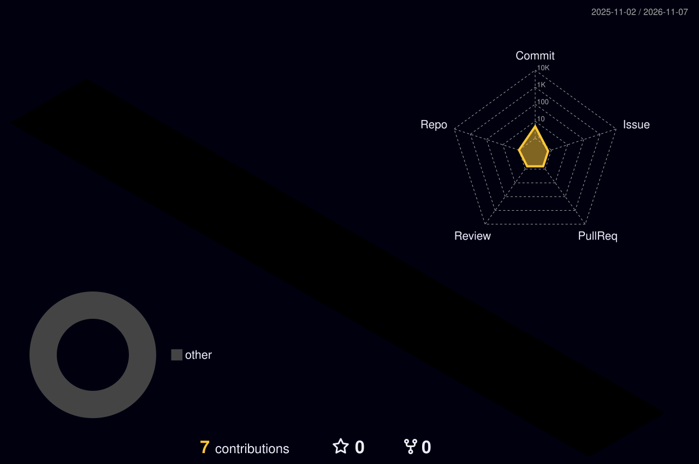

<!-- Banner -->
<p align="center">
  
</p>

<p align="center">
  <a href="https://github.com/BekoulAmine">
    
  </a>
</p>

<p align="center">
  
  
  
</p>

---

### 📜 Traveler Profile

```yaml
name:        Amine Bekoul
title:       Full-Stack Developer · CS Student @ ESI Algiers (4th year)
vision:      🌀 Anemo — always exploring new tech winds
main_quest:  Backend Engineering, DevOps, Cloud Computing & AI
side_quests: [scalable apps, software architecture, automation, AI x SWE]
motto:       "Building, breaking, learning, and building again."
```

- 🎓 Fourth-year Computer Science student at **ESI Algiers, Algeria**
- 💻 Full-Stack Developer who loves scalable applications and clean architecture
- ☁️ Exploring DevOps, cloud infrastructure and automation
- 🤖 Into AI and how it fits into software engineering
- 🎮 Genshin Impact enjoyer: my commits are as consistent as my daily commissions

---

### 🗡️ Daily Commission

<!--START_SECTION:teyvat-->
| 🌟 Character of the day | 🧭 Today's quest | 🎲 Daily wish |
|:-:|:--|:--|
| **Neuvillette**<br>💧 Hydro · Fontaine | Clean up your Docker images. Your storage is fuller than a 2000/2000 Mora bag. | 💙💙💙 Blue star... another **Slingshot**. Pity +1. |

<sub>🕒 Refreshed by GitHub Actions on 2026-11-07 (Teyvat server reset)</sub>
<!--END_SECTION:teyvat-->

---

### ⚔️ Party Setup (Tech Stack)

| Element | Role | Skills |
|:-:|:-:|:--|
| 🔥 **Pyro** | Main DPS · Languages |     |
| 💧 **Hydro** | Support · Frontend |      |
| 🪨 **Geo** | Shielder · Backend & DB |    |
| ⚡ **Electro** | Sub DPS · Tools |      |

---

### 📊 Adventure Stats

<p align="center">
  
  
</p>

<p align="center">
  
</p>

<p align="center">
  
</p>

---

### 🏔️ Contribution Map of Teyvat

<p align="center">
  
</p>

### 🐍 The Abyss Serpent eats my commits

<p align="center">
  
</p>

---

### 🗺️ Adventure Log (Recent Activity)

<!--START_SECTION:activity-->
<!--END_SECTION:activity-->

---

### 🎯 Current Quests

- [ ] DevOps practices, CI/CD pipelines and containerization
- [ ] Cloud infrastructure and virtualization
- [ ] Artificial Intelligence and Machine Learning
- [ ] Software architecture and scalable backend systems

---

### 🤝 Join my Party

I'm always open to interesting projects, collaborations and co-op runs with other developers.

[](https://www.linkedin.com/in/mohamed-amine-bekoul/)
[](https://github.com/BekoulAmine)

<p align="center">
  
</p>
