

  

# Amine Bekoul

- **Full-Stack Developer**  
- **Computer Science Engineering Student at [@ESI-Alger](https://esi.dz/)** (4th year)  
- **Into Backend Engineering, DevOps, Cloud Computing and AI**  
- **Always learning, building and experimenting with new technologies**  

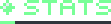

  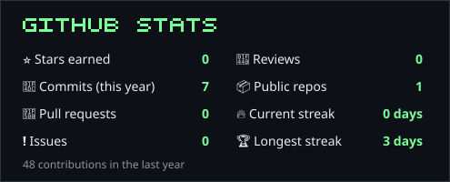
  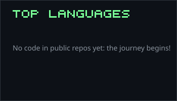

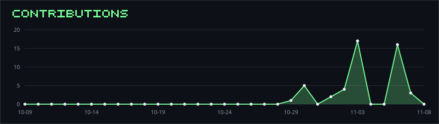

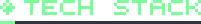

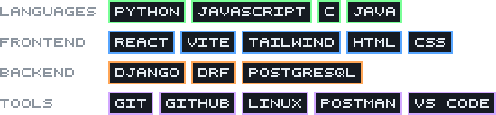

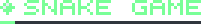

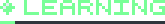

- DevOps practices, CI/CD pipelines and containerization
- Cloud infrastructure and virtualization
- Artificial Intelligence and Machine Learning
- Software architecture and scalable backend systems

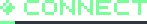

Open to interesting projects, collaborations and opportunities to learn from other developers.

- GitHub: [github.com/BekoulAmine](https://github.com/BekoulAmine)
- LinkedIn: [mohamed-amine-bekoul](https://www.linkedin.com/in/mohamed-amine-bekoul/)

---

> _"Building, breaking, learning, and building again."_

  

